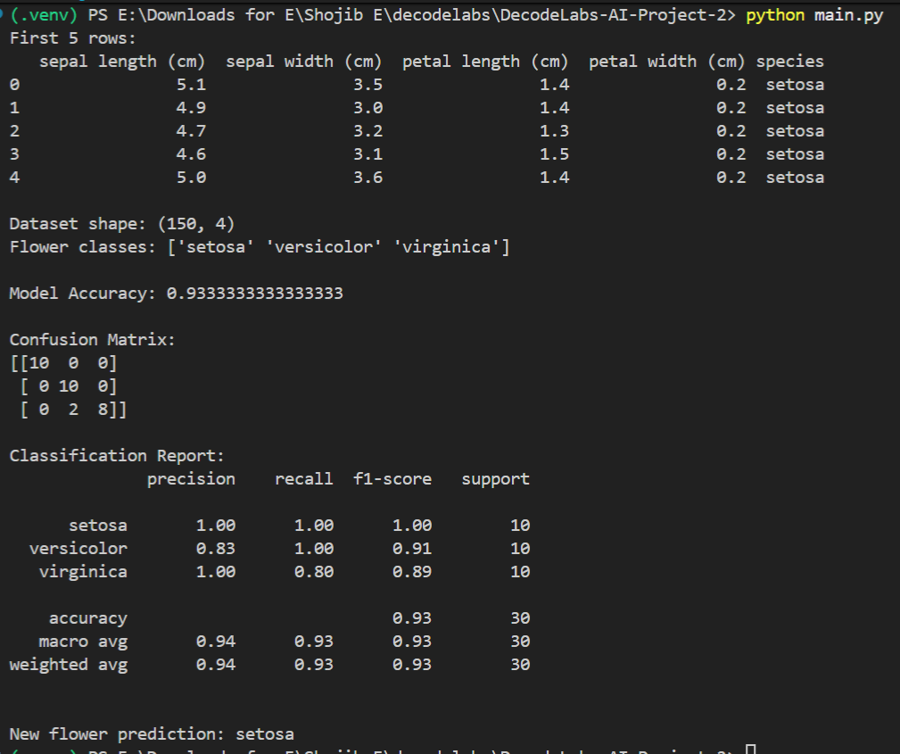

# IrisVision AI

A local-first Iris classification workbench with an interactive Streamlit dashboard, a command-line interface, and four machine-learning classifiers evaluated on the canonical Iris dataset.

## Overview

IrisVision AI uses the 150-record Iris dataset bundled locally in `data/iris.csv` to explore flower measurements, compare classification models, and predict a species from four measurements in centimeters. It preserves the original K-Nearest Neighbors (KNN) script and adds a dashboard, model-selection workflow, CLI, visualizations, and automated tests.

The project runs locally and uses no external APIs, runtime internet access, or credentials. Models are trained when the dashboard or CLI runs; no trained model binary is included.

## Features

- Streamlit dashboard with overview, interactive prediction, model comparison, dataset explorer, and model evaluation sections.
- Flower measurements entered manually or selected with sliders.
- Four selectable classifiers: KNN, Decision Tree, Random Forest, and Support Vector Machine (SVM).
- Model-produced species probability estimates where supported by the classifier.
- Stratified 5-fold cross-validation for model selection, confined to the training partition, followed by evaluation on a reserved stratified holdout.
- Accuracy, macro-averaged precision, recall and F1, classification reports, confusion matrices, and local runtime measurements.
- Interactive Plotly charts for dataset distributions, feature relationships, model metrics, runtimes, probability estimates, and confusion matrices.
- Command-line model comparison and optional flower prediction.
- Input validation and an extrapolation warning for measurements outside the training-data range.
- Automated tests for dataset handling, models, evaluation, and input validation.
- The original KNN implementation retained at `legacy/main.py`.

## Technology Stack

| Technology | Purpose |
|---|---|
| Python | Application and model implementation |
| Streamlit | Interactive local dashboard |
| scikit-learn | Classifiers, pipelines, cross-validation, and evaluation metrics |
| pandas and NumPy | Dataset handling and numerical input validation |
| Plotly | Interactive charts |
| pytest | Automated tests |

Dependency versions are pinned in `requirements.txt`.

## Project Structure

```text
.
├── app.py                         Streamlit dashboard and navigation
├── main.py                        CLI model comparison and prediction
├── irisvision/
│   ├── data.py                    Dataset loading and measurement validation
│   ├── evaluation.py              Model selection and holdout evaluation
│   ├── models.py                  Classifier pipelines and tuning grids
│   ├── prediction.py              Model-backed prediction helpers
│   └── visualizations.py          Plotly chart builders
├── data/
│   ├── iris.csv                   Local canonical Iris records
│   └── README.md                  Dataset source, schema, and integrity notes
├── legacy/
│   └── main.py                    Original KNN script
├── assets/
│   └── original_console_run.png   Original console output capture
├── results/
│   ├── model_comparison.csv       Recorded model metrics and runtimes
│   ├── classification_reports.json Per-class metrics from the recorded run
│   └── README.md                  Evaluation output notes
├── tests/
│   └── test_project.py            Automated tests
├── requirements.txt               Pinned dependencies
├── pytest.ini                     pytest configuration
├── .gitignore
├── LICENSE
└── README.md
```

## System Architecture

The dashboard and CLI share the Python modules in `irisvision/`. Both load the local CSV dataset, build and evaluate the model pipelines, and use the selected fitted pipeline for predictions. The dashboard presents those results with Streamlit and Plotly; the CLI prints evaluation results and optional prediction output in the terminal.

```text
Streamlit dashboard ─┐
                     ├── irisvision modules ── local data/iris.csv
Command-line interface┘          │
                                  └── scikit-learn pipelines and evaluation
```

## Models and Evaluation

The project evaluates four pipelines:

- **KNN:** `StandardScaler` followed by a K-Nearest Neighbors classifier.
- **Decision Tree:** a deterministic decision tree, without feature scaling.
- **Random Forest:** a deterministic random forest, without feature scaling.
- **SVM:** `StandardScaler` followed by an SVC configured to provide probability estimates.

The evaluation uses a stratified 80/20 train/test split with `random_state=42`. Hyperparameter selection uses stratified 5-fold cross-validation on the training partition and macro F1 scoring. The reserved test partition is evaluated after model selection. Preprocessing is part of each scikit-learn pipeline, so scaling is fit within training folds and not on the holdout data.

The packaged metrics in `results/model_comparison.csv` and per-class reports in `results/classification_reports.json` are outputs from a recorded run. Runtime values depend on the machine and software environment. Scores on this small, familiar dataset are illustrative and do not guarantee results on other data.

## Installation

Use Python 3.11 or 3.12. From the project root, create and activate a virtual environment, then install the pinned dependencies.

### Windows PowerShell

```powershell
py -3.11 -m venv .venv
.\.venv\Scripts\Activate.ps1
python -m pip install --upgrade pip
python -m pip install -r requirements.txt
```

If Python 3.11 is unavailable, create the environment with `py -3.12 -m venv .venv`. If PowerShell blocks activation, allow it for the current terminal with `Set-ExecutionPolicy -Scope Process -ExecutionPolicy Bypass`, then activate the environment again.

### Linux or macOS

```bash
python3 -m venv .venv
source .venv/bin/activate
python -m pip install --upgrade pip
python -m pip install -r requirements.txt
```

## Running the Project

### Dashboard

Run from the project root with the virtual environment activated:

```bash
streamlit run app.py
```

Open the local address printed by Streamlit. Use the sidebar to select a dashboard section and active classifier.

### Command-line interface

Evaluate all four classifiers:

```bash
python main.py
```

Evaluate the models and predict a species from sepal length, sepal width, petal length, and petal width, in centimeters:

```bash
python main.py --predict 5.1 3.5 1.4 0.2
```

Choose a classifier for the prediction:

```bash
python main.py --predict 6.0 2.9 4.5 1.5 --model "Support Vector Machine (SVM)"
```

The default prediction model is the original KNN baseline. The CLI performs model evaluation before making an optional prediction.

### Tests

Run the automated test suite from the project root:

```bash
python -m pytest -q
```

## Dataset

`data/iris.csv` contains the 150 canonical Iris observations, four numeric measurements in centimeters, and the species labels `setosa`, `versicolor`, and `virginica`. Each species has 50 records. Dataset source, schema, and integrity notes are documented in [`data/README.md`](data/README.md).

## Screenshot

The repository includes the original script's console output capture:



## Known Limitations

- The Iris dataset is small and educational; these results are not evidence of clinical or other high-stakes suitability.
- A predicted species and its probability estimates are model outputs, not certainty or causal explanations. SVM probabilities use scikit-learn's probability estimation.
- Positive finite measurements are accepted, including values outside the training range. The dashboard warns about out-of-range values, for which predictions may be unreliable.
- Runtime measurements are local diagnostics, not controlled benchmarks.
- The dashboard trains and tunes the models locally when loaded; a pre-trained model is not bundled.
- Windows setup commands are documented, but the project delivery was verified in a Linux sandbox rather than on a Windows device.

## Author

**SHOJIB-80** — [GitHub profile](https://github.com/SHOJIB-80)

## License

This project is licensed under the [MIT License](LICENSE).
